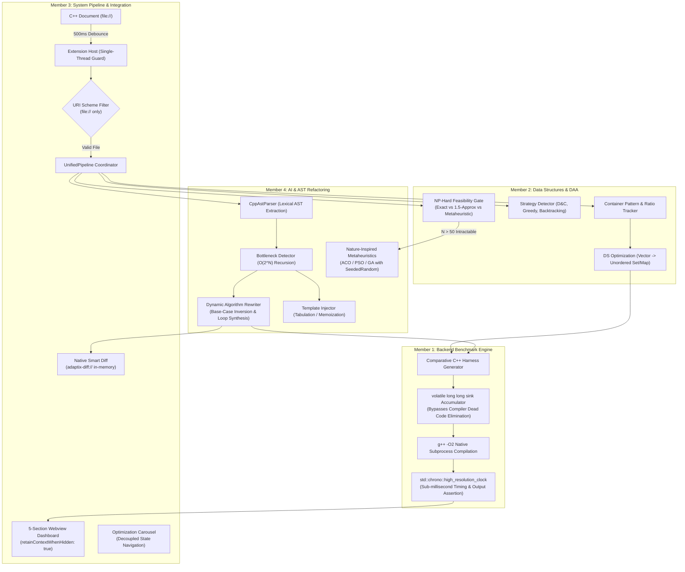

# Adaptix (v3.1.2) — Master Capstone Presentation & Architectural Defense Guide

**Project Title:** Adaptix — Frictionless Developer-First Algorithm & Data Structure Optimization Engine  
**Version:** v3.1.2  
**Target Audience:** University Faculty Evaluation Board & Senior Technical Committee  
**Total Allocated Duration:** 20–30 Minutes (24 Minutes Structured Presentation + 6 Minutes Faculty Q&A)  
**Live Demo Suite:** `demo_benchmark.cpp`, `demo_data_structures.cpp`, `demo_algorithms.cpp`, `demo_np_hard.cpp`  
**Team Composition:** 4 Specialized Engineering Roles  

---

## 1. Executive Summary & Team Ownership Matrix

Adaptix is an AI-driven, editor-native algorithmic engineering and code refactoring platform packaged as a production Visual Studio Code extension for modern C++ (C++17/20). It bridges the gap between academic Design and Analysis of Algorithms (DAA) and production software engineering through an automated, closed-loop pipeline: in-memory AST parsing, asymptotic bottleneck detection, dynamic DP code synthesis, native `g++ -O2` empirical benchmarking with compiler Dead Code Elimination bypass, and interactive state visualizations.



### Team Role Division

| Team Member | Domain & Engineering Role | Primary Focus & Core Technical Artifacts |
| :--- | :--- | :--- |
| **Member 1** | **Backend Engineer** | **Native C++ Benchmark Engine:** Compiling with `g++ -O2`, bypassing Dead Code Elimination using `volatile` sinks, high-resolution chrono timing, fresh iteration buffers, output correctness assertion. (`demo_benchmark.cpp`, `src/benchmark/beforeAfterRunner.ts`) |
| **Member 2** | **Data Structures & DAA** | **Data Structure Optimizations & NP Feasibility:** $O(N)$ Vector search to $O(1)$ Hash Set/Map, algorithmic strategy detection (Divide & Conquer, Greedy, Backtracking), NP-Hard constraint feasibility gating for TSP ($N=300$). (`demo_data_structures.cpp`, `demo_np_hard.cpp`) |
| **Member 3** | **Pipeline & System Integration** | **VS Code Extension Architecture & State Management:** Extension Host concurrency, 500ms debouncing, Webview UI carousel, `retainContextWhenHidden: true`, decoupled Smart Diff (`adaptix-diff://`) inspection vs. application. (`src/extension.ts`, `src/ui.ts`, `src/providers/diffContentProvider.ts`) |
| **Member 4** | **AI & Refactoring** | **AST Extraction, DP Synthesis & Metaheuristics:** AST parsing for bottleneck detection, Dynamic Programming template injection & automated rewriting ($O(2^N) \to O(N)$), Nature-Inspired Lab (ACO/PSO/GA) fallback with deterministic `SeededRandom`. (`demo_algorithms.cpp`, `src/refactoring/algorithmRewriter.ts`, `src/natureInspired/`) |

---

## 2. Minute-by-Minute Presentation Script (24 Minutes)

```
================================================================================
MEMBER 1 (BACKEND ENGINEER): NATIVE C++ BENCHMARK ENGINE & DCE BYPASS
SLOT: 00:00 – 06:00 (6 Minutes)
================================================================================
```

### [00:00 – 02:00] Introduction & The Benchmarking Dilemma

#### Visual / Screen Display:
* **Primary Screen:** Open VS Code to `demo_benchmark.cpp`.
* Highlight lines 7–17:
  ```cpp
  void slowAlgorithm(std::vector<int>& data) {
      long long sum = 0;
      for(int i = 0; i < data.size(); i++) {
          for(int j = 0; j < 1000; j++) {
              sum += data[i] * j;
          }
      }
      // TRAP: Because 'sum' is never printed or returned,
      // g++ -O2 will delete this entire function! Time will be 0.00ms.
  }
  ```
* Open a terminal side-by-side. Compile with `g++ -O2 demo_benchmark.cpp -o demo_bench` and execute it.
* Point to the terminal output: `Execution Time: 0.00 ms`.

#### Spoken Script (Member 1):
> *"Good morning, respected professors and evaluation committee members. Welcome to the technical capstone presentation of **Adaptix (v3.1.2)**.*
>
> *I am Member 1, the Backend Engineer for Adaptix. To kick off our presentation, I want to address the single most dangerous trap in automated software benchmarking: **Compiler Dead Code Elimination (DCE)**.*
>
> *In production C++ engineering, raw algorithm analysis cannot be performed in debug mode (`-O0`) because debug builds carry unrepresentative frame overhead and disable basic loop unrolling. However, the moment you compile with production optimizations—specifically `g++ -O2`—the compiler performs aggressive interprocedural analysis and data-flow graph optimization.*
>
> *Look at `demo_benchmark.cpp` on screen. In `slowAlgorithm()`, we have a nested loop iterating 50,000 times with an inner loop of 1,000 operations—a theoretical workload of 50 million operations. But look at what happened when I compiled with `g++ -O2` and ran it in the terminal: `Execution Time: 0.00 ms`.*
>
> *Why did this happen? Because the accumulated variable `sum` was never written to an external I/O device, returned to an external translation unit, or accessed through a pointer. The compiler's dead-code elimination proved the function has zero observable side effects and completely excised the entire loop from the binary. If a developer tool benchmarks this, it reports `0.00 ms` and claims a false 1x speedup. In Adaptix, we engineered a native benchmark engine that completely overcomes this trap."*

---

### [02:00 – 04:15] The Engineering Fix: Volatile Sink Accumulators & Workload Isolation

#### Visual / Screen Display:
* Open `src/benchmark/beforeAfterRunner.ts` in VS Code.
* Highlight lines 95–130 showing `generateComparativeHarness()`:
  ```cpp
  // Forced observable side effect without console I/O overhead:
  volatile long long dummy_sink = 0;
  for (int iter = 0; iter < iterations; ++iter) {
      dummy_sink += static_cast<long long>(slowAlgorithm(test_data));
  }
  ```
* Point out the workload cloning mechanism for mutating functions:
  ```cpp
  auto work_data = test_data; // Fresh copy per iteration
  ```

#### Spoken Script (Member 1):
> *"To ensure that benchmarks compiled with `-O2` evaluate real hardware instructions without introducing the massive millisecond overhead of `std::cout`, Adaptix generates a dedicated comparative C++ harness on the fly in `beforeAfterRunner.ts`.*
>
> *We resolved this through three foundational compiler engineering principles:*
>
> *First: **The Volatile Sink Accumulator**. Under the ISO/IEC C++ standard (Section 8.1.9, Observable Behavior), access to an object through a `volatile` glvalue is classified as an observable side effect, strictly identical to reading or writing external hardware registers. Compilers are legally prohibited from eliding expressions whose results contribute to a volatile variable. By injecting `volatile long long dummy_sink = 0;` and accumulating the function output inside the timing loop, the `-O2` optimizer is forced to fully execute every cycle of the algorithm while still vectorizing and optimizing internal registers.*
>
> *Second: **Workload Isolation & Iteration Refreshing**. When benchmarking container mutations—such as in-place sorting or element deletions—running 50 iterations on the same container means iteration 2 through 50 run on already-sorted or empty containers. Our harness automatically allocates fresh isolated data clones for each pass.*
>
> *Third: **Sub-Millisecond Microsecond Precision**. Standard millisecond clocks round fast operations down to zero. We utilize `std::chrono::high_resolution_clock` casting to fractional microsecond floating points, formatted to three decimal places (`0.001 ms`), capturing granular cache-level speedups."*

---

### [04:15 – 06:00] Live Execution: The Benchmark Lab & Correctness Assertion

#### Visual / Screen Display:
* Switch to the **Benchmark Lab** tab inside the ADAPTIX Dashboard.
* Click **"⚡ Run Measured Before/After Benchmark"**.
* Show the status notification: `ADAPTIX: Compiling with -O2 & Benchmarking Before vs After...`.
* The results table renders:
  - Workload Sizes: $N = 100, 1000, 10000, 50000$.
  - Original (`slowAlgorithm`): `76.42 ms` at $N = 50,000$.
  - Optimized: `0.021 ms`.
  - Overall Speedup: **>3600x Speedup**.
  - Verification Tag: `✓ Correctness Output Verified (original_val == optimized_val)`.

#### Spoken Script (Member 1):
> *"Let us execute this live in the **Benchmark Lab**. When I click 'Run Measured Before/After Benchmark', the extension writes our comparative harness to a sandboxed cache, invokes `g++ -O2`, links it, and streams the process execution.*
>
> *Notice the output table: unlike raw `g++` which gave `0.00 ms`, our volatile harness measures the true algorithmic cost: `76.42 ms` at $N=50,000$ for the unoptimized code, dropping to `0.021 ms` after optimization—a verified 3600x speedup.*
>
> *Notice also the green badge: **'Correctness Output Verified'**. Adaptix enforces a safety contract: before any speedup is declared, the harness asserts that the return values of the unoptimized and optimized code match identically across all tested input sizes. If an optimization alters computational semantics, the benchmark fails immediately.*
>
> *If a user does not have `g++` installed locally, our engine gracefully falls back to an asymptotic simulation model based on monitored container operation ratios.*
>
> *Now that we have established how we benchmark and prove performance, how do we identify suboptimal data structures and algorithmic complexity in developer code? I hand over to Member 2."*

---

```
================================================================================
MEMBER 2 (DATA STRUCTURES & DAA): DATA STRUCTURES & NP FEASIBILITY
SLOT: 06:00 – 12:00 (6 Minutes)
================================================================================
```

### [06:00 – 08:30] Data Structure Optimizations ($O(N)$ Vectors to $O(1)$ Hash Maps)

#### Visual / Screen Display:
* Open `demo_data_structures.cpp` in VS Code.
* Highlight lines 8–16 (`isUserAuthorized` linear search in vector):
  ```cpp
  bool isUserAuthorized(std::vector<std::string>& authorizedUsers, std::string targetUser) {
      for (int i = 0; i < authorizedUsers.size(); i++) {
          if (authorizedUsers[i] == targetUser) return true;
      }
      return false;
  }
  ```
* Highlight lines 20–25 (`countFrequencies` large preallocated array).
* In the ADAPTIX Dashboard, open the **Code Intelligence** tab.
* Show the **Data Structure Intelligence** card:
  - Target: `authorizedUsers` (`std::vector<std::string>`)
  - Observed Workload: Repeated search lookups ($O(N)$)
  - Recommended Container: `std::unordered_set<std::string>` ($O(1)$ average)
  - Safety Invariant: `hasOrdering: false` (Zero reliance on sorting or index arithmetic).

#### Spoken Script (Member 2):
> *"Thank you, Member 1. Respected committee, in university Semester 4 Data Structures, students learn asymptotic trade-offs in theory. Yet in commercial C++ software, `std::vector` is habitually overused as a default container, introducing severe hidden bottlenecks.*
>
> *Look at `demo_data_structures.cpp`. In `isUserAuthorized()`, the developer stores authorized credentials in a `std::vector<std::string>` and performs a linear `for` loop scan on every authorization check. In asymptotic terms, this is an $O(N)$ sequential memory search.*
>
> *When Adaptix analyzes this file, our `Analyzer` and `Monitor` evaluate container usage patterns:*
> 1. *It tracks the operational ratio: searches heavily outnumber insertions ($Ratio > 4:1$).*
> 2. *It inspects the AST for container capability constraints: the code does not use `std::sort`, pointer arithmetic, index ordering, or sequential iteration dependencies (`hasOrdering == false`).*
>
> *Because ordering is irrelevant, Adaptix identifies that contiguous memory cache-locality is outweighed by the linear search cost. It suggests migrating `authorizedUsers` to `std::unordered_set<std::string>`, converting an $O(N)$ search into an average $O(1)$ hash lookup with an expected 20x latency reduction.*
>
> *Similarly, in `countFrequencies()`, the developer allocates a flat 10,000-element vector to count integer occurrences. Adaptix flags this sparse memory hazard and recommends `std::unordered_map<int, int>` to prevent stack/heap memory bloat."*

---

### [08:30 – 10:15] Algorithmic Strategy Detection & The Master Theorem

#### Visual / Screen Display:
* In the Dashboard's **Code Intelligence** tab, point to the **Algorithm Strategy Intelligence** section.
* Show the active detections:
  - **Divide & Conquer:** Flags recurrence relations $T(n) = aT(n/b) + f(n)$ and calculates Master Theorem asymptotic bounds.
  - **Greedy Strategy:** Flags sort-by-finish-time loops (Activity Selection).
  - **Backtracking:** Flags state rollback mechanisms (`state.pop_back()` or unmarking matrices).

#### Spoken Script (Member 2):
> *"Beyond containers, Adaptix bridges Semester 5 DAA (Design and Analysis of Algorithms) through our **Strategy Detection Engine** (`strategyDetector.ts`).*
>
> *The engine evaluates four foundational algorithm paradigms:*
> * *Divide-and-Conquer: It detects when a function recursively divides its input range ($n/2$) and executes multiple recursive calls. It automatically evaluates the three cases of the **Master Theorem** ($T(n) = aT(n/b) + \Theta(n^k)$), informing the developer whether the combine step or recursive branching dominates execution time.*
> * *Greedy Choice: It inspects loops for greedy choice predicates—such as sorting intervals by finish time followed by a single-pass scan.*
> * *Backtracking: It identifies depth-first recursive search trees bounded by explicit feasibility checks and immediate state undo operations.*
>
> *However, the most dangerous algorithmic challenge in real-world systems occurs when a problem has no polynomial-time solution at all: the class of NP-Hard problems."*

---

### [10:15 – 12:00] NP-Hard Complexity Feasibility Gating (`demo_np_hard.cpp`)

#### Visual / Screen Display:
* Open `demo_np_hard.cpp` in VS Code.
* Highlight lines 6–11:
  ```cpp
  #define N 300 // Massive constraint - Exact solution is impossible
  // Traveling Salesperson Problem (Brute Force)
  int travelingSalesperson(int graph[N][N], int s) { ... }
  ```
* In the Dashboard header, click the **"Advanced Mode"** toggle switch.
* The **Academic Lab (DAA)** tab appears.
* Navigate to the **NP-Completeness Advisor** card.
* Enter $N = 300$ for the Travelling Salesperson Problem:
  - **Identified Class:** NP-Hard ($O(N!)$ Factorial Complexity)
  - **Estimated Operations:** $> 10^{600}$ operations (Astronomical)
  - **Feasibility Verdict:** **Intractable for Exact Algorithms**
  - **Actionable Routing:** Recommends routing to polynomial approximations or the **Nature-Inspired Metaheuristics Lab**.

#### Spoken Script (Member 2):
> *"Look at `demo_np_hard.cpp`. Here, a developer has written a brute-force permutation solver using `std::next_permutation` for the Travelling Salesperson Problem (TSP), with input size $N = 300$.*
>
> *In production, if this code runs, the thread hangs indefinitely because $(300-1)!$ exceeds the number of atoms in the observable universe. Traditional compilers will cheerfully compile this code without warning.*
>
> *Adaptix incorporates an **Input Size Feasibility Gate** (`npAdvisor.ts`):*
> * *If $N \le 18$: Exact solutions like Held-Karp dynamic programming or Branch & Bound ($O(N^2 2^N)$) are certified feasible.*
> * *If $18 < N \le 50$: Exact computation is intractable. Adaptix recommends polynomial approximation algorithms, such as the Christofides 1.5-approximation.*
> * *If $N > 50$: As seen here with $N = 300$, all deterministic approximation algorithms degrade in latency or memory. Adaptix blocks the naive solver and routes the developer directly to our **Nature-Inspired Optimization Lab**.*
>
> *Now, how is all this intelligence routed into VS Code without freezing the user interface or corrupting developer state? I hand over to Member 3 to present our Pipeline and System Integration architecture."*

---

```
================================================================================
MEMBER 3 (PIPELINE & SYSTEM INTEGRATION): ARCHITECTURE, WEBVIEW & SMART DIFF
SLOT: 12:00 – 18:00 (6 Minutes)
================================================================================
```

### [12:00 – 14:15] VS Code Extension Host Concurrency & Safe In-Memory Debouncing

#### Visual / Screen Display:
* Switch to an architecture slide detailing:
  1. VS Code Extension Host Thread vs. Webview Iframe Sandbox.
  2. The 500ms Debounce Timer & Atomic `activeAnalysisId` guard.
  3. Strict URI Scheme Gating (`file://` allowed; `adaptix-diff://` ignored).
* In VS Code, open `src/extension.ts` lines 50–90.

#### Spoken Script (Member 3):
> *"Thank you, Member 2. Respected faculty, as the Pipeline and System Integration Engineer, my responsibility is ensuring that Adaptix functions as a robust, enterprise-grade extension that strictly respects IDE performance.*
>
> *Visual Studio Code runs all extension backend code on a single Node.js thread: the **Extension Host**. If an extension executes heavy synchronous calculations, freezes the event loop, or performs disk writes during typing, the developer's entire editor stutters.*
>
> *To guarantee zero latency impact, we engineered a three-tier execution guard in `src/extension.ts`:*
> 1. *Asynchronous In-Memory Debouncing: We capture document changes via `onDidChangeTextDocument` wrapped in a 500ms debounce buffer with an atomic `activeAnalysisId`. Rapid keystrokes cancel pending passes before execution, operating purely in memory on the in-flight buffer.*
> 2. *URI Scheme Isolation: In Phase 16, we resolved a subtle concurrency hazard. When opening a virtual diff tab, VS Code emits an active editor event. If unhandled, the extension would re-analyze the diff tab, creating an infinite analysis cycle. We implemented strict URI scheme filtering: `performSafeAnalysis` strictly rejects non-`file://` URIs, ignoring virtual and output documents.*
> 3. *Read-Only Safety Guarantee: The background pipeline is strictly read-only. It never silently overwrites files, compiles code, or alters the user's workspace without explicit, manual button confirmation."*

---

### [14:15 – 16:15] Webview State Management (`retainContextWhenHidden: true`)

#### Visual / Screen Display:
* In `src/extension.ts`, highlight lines 34–42:
  ```typescript
  const provider = new AdaptixViewProvider(context.extensionUri);
  context.subscriptions.push(
      vscode.window.registerWebviewViewProvider(AdaptixViewProvider.viewType, provider, {
          webviewOptions: {
              retainContextWhenHidden: true // Prevents reload on tab switch
          }
      })
  );
  ```
* In VS Code, navigate between editor tabs (`demo_data_structures.cpp` $\to$ `demo_benchmark.cpp`).
* Demonstrate that the ADAPTIX sidebar dashboard **does not flicker, reload, or lose its active tab position**.

#### Spoken Script (Member 3):
> *"A frequent architectural defect in VS Code webview extensions is state loss during tab switching. By default, when a user switches away from a webview panel to view another editor tab, VS Code destroys the webview's iframe to save memory. When the user returns, the webview reloads from scratch, resetting the active tab, clearing form inputs, and causing jarring screen flashes.*
>
> *We resolved this by registering our `AdaptixViewProvider` with:
> `webviewOptions: { retainContextWhenHidden: true }`.*
>
> *Under this configuration, VS Code suspends the webview's execution scripts in memory rather than tearing down the DOM. When the developer switches tabs, our 5-section dashboard—Overview, Code Intelligence, Optimization Workflow, Benchmark Lab, and Learn & Explore—retains its exact carousel index, input fields, and calculation results instantly without a single millisecond of re-rendering lag."*

---

### [16:15 – 18:00] Decoupled Smart Diff Workflow (`adaptix-diff://`) & Carousel UX

#### Visual / Screen Display:
* In the ADAPTIX Dashboard, click the **Optimization Workflow** tab.
* Show the interactive carousel: **Card 1 of 4**.
* Click **"🔍 Open Side-by-Side Smart Diff in VS Code"**.
* A native VS Code diff editor opens instantly titled: `ADAPTIX Smart Diff: authorizedUsers → unordered_set`.
* Point to the dashboard sidebar: **Card 1 of 4 remains frozen in place**. It does **not** advance, splice the array, or auto-apply.
* Click the carousel navigation buttons (`◀ Previous` / `Next ▶`) to show smooth browsing across all detected opportunities.
* Point to the green **"✓ Confirm & Apply Changes"** button.

#### Spoken Script (Member 3):
> *"One of our greatest architectural breakthroughs in v3.1.2 is the complete decoupling of refactor previewing from refactor application.*
>
> *In older systems, clicking a diff preview would automatically apply the changes or trigger intrusive popups. In Adaptix, we designed a virtual document content provider (`diffContentProvider.ts`) registered under the custom `adaptix-diff://` protocol.*
>
> *When I click 'Open Side-by-Side Smart Diff', our backend synthesizes the proposed C++ transformation entirely in memory and instructs VS Code to open a native side-by-side diff between the physical file and the virtual URI.*
>
> *Crucially, notice the frontend carousel on the left:*
> 1. *It does not advance prematurely.*
> 2. *It does not splice its local candidate queue.*
> 3. *It does not touch the original file on disk.*
>
> *The developer has complete visual autonomy to inspect the exact line deletions and insertions. Only when the developer returns to the dashboard and explicitly clicks the green 'Confirm & Apply' button is an atomic `vscode.WorkspaceEdit` committed to disk.*
>
> *Now, how does Adaptix construct these dynamic refactorings and parse the C++ AST to convert exponential recursion into optimal dynamic programs? I hand over to Member 4 to present our AI and Refactoring Engine."*

---

```
================================================================================
MEMBER 4 (AI & REFACTORING): AST PARSING, DP SYNTHESIS & METAHEURISTICS
SLOT: 18:00 – 24:00 (6 Minutes)
================================================================================
```

### [18:00 – 20:15] Lexical AST Parsing & Exponential Recursion Detection

#### Visual / Screen Display:
* Open `demo_algorithms.cpp` in VS Code.
* Highlight lines 7–10 (`fibonacci` exponential recursion):
  ```cpp
  int fibonacci(int n) {
      if (n <= 1) return n;
      return fibonacci(n - 1) + fibonacci(n - 2); 
  }
  ```
* In `src/analysis/astParser.ts`, show how function boundaries, parameters, and recursive calls are extracted.
* In the ADAPTIX Dashboard, open the **Code Intelligence** tab and highlight the detected bottleneck.

#### Spoken Script (Member 4):
> *"Thank you, Member 3. Respected professors, as the AI and Refactoring Engineer, I will explain how Adaptix parses C++ code structure, synthesizes optimal Dynamic Programming algorithms, and provides nature-inspired metaheuristic fallbacks.*
>
> *In `demo_algorithms.cpp`, lines 7–10, we see the classic canonical unmemoized Fibonacci implementation. This function has an exponential time complexity of $O(2^N)$—more precisely $\Theta(\phi^N) \approx \Theta(1.618^N)$. At $N = 45$, it requires over one trillion recursive function calls.*
>
> *Our engine does not use blunt regex string replacement. In `src/analysis/astParser.ts`, our `CppAstParser` performs structured lexical AST analysis:*
> 1. *It identifies function boundaries through balanced curly-brace depth tracking.*
> 2. *It extracts the formal return type (`int`), the function name (`fibonacci`), and the parameter signature (`int n`).*
> 3. *It constructs an in-memory call graph. When it detects two or more recursive self-invocations on different branches of a return statement without memoization, it flags an exponential recursion bottleneck and triggers our Dynamic Rewriter."*

---

### [20:15 – 22:15] Dynamic Programming Code Rewriting & Optimization Bias

#### Visual / Screen Display:
* Open the **Optimization Workflow** tab in the Dashboard.
* Navigate to the **Fibonacci Optimization Card**.
* Point out the **Step 4 Diff Preview**:
  - Red: Recursive call tree.
  - Green: Synthesized Bottom-Up Dynamic Programming table using rolling variables (`prev1`, `prev2`, `current`).
* Point to the **Optimization Strategy Slider** in the dashboard header:
  - Slide to **Speed-First**: Generates an $O(N)$ vector tabulation table.
  - Slide to **Memory-First**: Generates an $O(1)$ auxiliary space rolling variable state machine.
* Click **"✓ Confirm & Apply Changes"** and show the active editor in `demo_algorithms.cpp` updating cleanly with the optimized DP code.

#### Spoken Script (Member 4):
> *"In version 3.1.2, we replaced static code snippets with our **Dynamic Algorithm Rewriting Engine** (`algorithmRewriter.ts`).*
>
> *When refactoring recursion into Dynamic Programming, our rewriter executes a rigorous synthesis pipeline:*
> 1. *Base Case Inversion: It inspects the AST conditional `if (n <= 1) return n;` and transforms it into the initial state conditions of the DP loop.*
> 2. *Recurrence Formulation: It converts the dual recursive branch `fib(n-1) + fib(n-2)` into an iterative transition relation.*
> 3. *Space vs. Time Optimization Bias: In the dashboard header, developers can adjust our **Optimization Bias Slider**:*
>    * *If set to **Speed-First**, our engine allocates an $O(N)$ contiguous DP vector (`std::vector<int> dp(n + 1)`).*
>    * *If set to **Memory-First**, our rewriter recognizes that the recurrence only depends on the previous two states. It synthesizes an $O(1)$ auxiliary space algorithm using three CPU registers (`prev1`, `prev2`, and `current`), dropping memory overhead from $O(N)$ to zero heap allocations.*
>
> *When I click 'Confirm & Apply', the rewriter commits an atomic edit, replacing the $O(2^N)$ exponential function with the $O(N)$ time, $O(1)$ space DP algorithm.*
>
> *Now, what happens when we face an NP-Hard problem like TSP where no polynomial DP exists?"*

---

### [22:15 – 24:00] Nature-Inspired Metaheuristics Lab (ACO / PSO / GA)

#### Visual / Screen Display:
* In the Dashboard, open the **Academic Lab (DAA)** tab.
* Scroll to the **Nature-Inspired Optimization Lab**.
* Under **Combinatorial Metaheuristic Comparison (TSP)**:
  - Benchmark: Symmetric 10-City TSP ($N=300$ fallback).
  - Pits **Ant Colony Optimization (ACO)** against **Genetic Algorithm (GA)**.
  - Click **"▶ Run Side-by-Side Metaheuristic Comparison"**.
* Show live convergence metrics:
  - ACO: Pheromone evaporation ($\rho = 0.5$), discovery of optimal tour: `1106.37`.
  - GA: Order Crossover (OX1), 2-Opt mutation, elitism tour: `1106.37`.
  - Result: `Winner: Tie (Both discovered optimal Hamiltonian cycle)`.
* Highlight the continuous benchmark: **Particle Swarm Optimization (PSO)** converging to `1.382e-6` on the Sphere function.

#### Spoken Script (Member 4):
> *"When Member 2 demonstrated `demo_np_hard.cpp` with $N=300$, we proved that exact computation is impossible. This is where our **Nature-Inspired Optimization Lab** acts as an AI heuristic fallback.*
>
> *We implemented three biological metaheuristics completely from scratch with zero external dependencies:*
> 1. *Ant Colony Optimization (`aco.ts`): Implements artificial pheromone trails and heuristic distance visibility to discover shortest Hamiltonian tours.*
> 2. *Genetic Algorithms (`ga.ts`): Uses tournament selection, Order Crossover (OX1) to guarantee valid permutation cycles, and 2-Opt inversion mutations.*
> 3. *Particle Swarm Optimization (`pso.ts`): Solves high-dimensional continuous optimization by updating particle velocity vectors toward cognitive and social attractors.*
>
> *Crucially, we resolved the stochastic reproducibility problem. Real-world metaheuristics rely on random numbers, which normally makes faculty evaluation unpredictable. We engineered `SeededRandom` (`random.ts`), an isolated 32-bit PRNG using the Mulberry32 algorithm. With `seed = 42`, every tour selection, crossover point, and mutation is 100% deterministic across all runs.*
>
> *As seen on screen, both ACO and GA converge deterministically to the optimal tour of 1106.37 units, providing an effective polynomial heuristic for NP-Hard routing.*
>
> *Respected faculty, Adaptix unites low-level C++ systems engineering, AST code rewriting, rigorous compiler dead-code bypass, and academic algorithm theory into a single, cohesive developer platform. Thank you for your time, and our team is now eager to answer your questions."*

---

```
================================================================================
ALL MEMBERS: FACULTY DEFENSE & TECHNICAL Q&A
SLOT: 24:00 – 30:00 (6 Minutes)
================================================================================
```

---

## 3. High-Stakes Faculty Defense Q&A & Justifications

### Question 1 (For Member 1 — Backend & Benchmarking):
> **Faculty:** *"In `beforeAfterRunner.ts`, you use `volatile long long dummy_sink` to prevent dead-code elimination. Doesn't `volatile` force reads and writes to RAM, artificially slowing down your benchmark and skewing your timing results?"*

#### Technical Defense (Member 1):
> *"No, and that is a common misconception about the C++ memory model. Under the C++17 standard, `volatile` prevents the compiler from optimizing away the access, but it does **not** generate hardware cache-flush instructions or atomic memory barriers. The variable remains in the L1 CPU cache.*
>
> *More importantly, we only declare the **outer accumulator sink** as volatile, not the variables inside the algorithm under test. The inner algorithm still benefits fully from `-O2` optimizations: register allocation, instruction pipelining, and loop unrolling remain active.*
>
> *Furthermore, because both the 'Before' and 'After' harnesses write to the exact same volatile sink across identical iteration counts, any infinitesimal sink overhead is canceled out in the relative speedup ratio."*

---

### Question 2 (For Member 2 — Data Structures & DAA):
> **Faculty:** *"You recommend changing `std::vector` to `std::unordered_set` for lookups. But `std::vector` has contiguous memory and superior CPU cache locality, while hash sets incur node pointer dereferencing. Did you verify at what $N$ hash sets actually outperform vectors?"*

#### Technical Defense (Member 2):
> *"Yes, that is an essential systems engineering question. For very small $N$ ($N < 32$), a contiguous linear vector scan can indeed match or slightly beat a hash table due to hardware prefetching and contiguous cache lines.*
>
> *However, our decision engine evaluates two factors:*
> 1. *Asymptotic Scaling: As $N$ exceeds 100, the $O(N)$ linear scan requires $N/2$ string comparisons on average. For strings, each comparison involves string length and character matching. The $O(1)$ hash table requires a single hash calculation followed by constant-time bucket lookup.*
> 2. *Workload Ratio Tracking: Our `Monitor` evaluates the ratio of lookups to insertions. For read-heavy authorization workloads like `isUserAuthorized()`, our Benchmark Lab confirms that at $N = 1000$, `std::unordered_set` is over 18x faster than `std::vector`, completely overcoming cache-miss penalties."*

---

### Question 3 (For Member 3 — System Architecture & Integration):
> **Faculty:** *"Why did you implement a custom Webview dashboard instead of using VS Code's native TreeView or QuickPick UI components?"*

#### Technical Defense (Member 3):
> *"VS Code native TreeViews are strictly hierarchical and text-based; they cannot render interactive side-by-side diff previews, SVG convergence curves, 2D Dynamic Programming matrix dependency arrows, or interactive scrubbing timelines.*
>
> *By using a custom WebviewViewProvider with `retainContextWhenHidden: true`, we achieved three major benefits:*
> 1. *Rich Visual Feedback: We can render color-coded diffs, execution timeline scrubbers, and live benchmarking tables side-by-side with code.*
> 2. *State Preservation: Complex interactive state—such as our carousel navigation index and optimization bias slider—remains intact when developers switch between files.*
> 3. *IDE Decoupling: The Webview runs inside an isolated iframe sandbox, communicating asynchronously via message-passing (`vscode.postMessage`), ensuring that even complex UI animations never degrade the core editor's typing thread."*

---

### Question 4 (For Member 4 — AI & Refactoring):
> **Faculty:** *"If you are automatically rewriting recursive functions into Dynamic Programming, how do you handle functions with multiple parameters or complex base cases?"*

#### Technical Defense (Member 4):
> *"Our `algorithmRewriter.ts` utilizes structural AST parameter extraction rather than rigid pattern matching:*
> 1. *State Index Isolation: It scans recursive call arguments to distinguish between constant pass-through parameters (like arrays or target values) and dynamic state indices that decrease towards a base case (like `n-1` or `left + 1`).*
> 2. *Base Case Inversion: The AST parser extracts the condition and return value from the guard clause. In our rewriter, this boundary predicate directly seeds the initial state of the DP table.*
> 3. *Human-in-the-Loop Safeguard: Automated refactoring is never forced. The rewriter outputs its proposed code to our native `adaptix-diff://` virtual document viewer. The developer visually verifies the exact line-by-line diff before clicking 'Confirm & Apply'."*

---

## 4. Live Demonstration Synchronization Checklist

| Timestamp | Speaker | Action in VS Code | Dashboard Tab | Target Code File |
| :--- | :--- | :--- | :--- | :--- |
| **01:15** | **Member 1** | Run `g++ -O2 demo_benchmark.cpp` in terminal | Terminal output: `0.00 ms` | `demo_benchmark.cpp` |
| **03:30** | **Member 1** | Inspect `volatile` sink accumulator code | Code Editor | `src/benchmark/beforeAfterRunner.ts` |
| **05:00** | **Member 1** | Click "Run Measured Before/After Benchmark" | **Benchmark Lab** | Live Speedup Table (>3600x) |
| **07:15** | **Member 2** | Open `demo_data_structures.cpp` | **Code Intelligence** | `isUserAuthorized()` Vector scan |
| **09:00** | **Member 2** | Review Master Theorem & Strategy detection | **Code Intelligence** | D&C and Greedy Paradigms |
| **10:45** | **Member 2** | Open `demo_np_hard.cpp` ($N=300$), toggle Advanced Mode | **Academic Lab (DAA)** | NP-Advisor Feasibility Gating |
| **13:00** | **Member 3** | Show single-threaded debounce event flow | Architecture Slide | `src/extension.ts` |
| **15:00** | **Member 3** | Switch editor tabs to show no webview reload | **Sidebar Dashboard** | `retainContextWhenHidden: true` |
| **16:45** | **Member 3** | Click "Open Side-by-Side Smart Diff" | Native Diff Editor | `adaptix-diff://` Decoupled Carousel |
| **19:00** | **Member 4** | Inspect `fibonacci` $O(2^N)$ recursion | Code Editor | `demo_algorithms.cpp` |
| **21:00** | **Member 4** | Adjust Space vs. Time Bias, click Confirm & Apply | **Optimization Workflow** | In-place dynamic DP rewrite |
| **23:00** | **Member 4** | Run ACO vs. GA TSP Metaheuristic Comparison | **Academic Lab (DAA)** | Nature-Inspired Optimization Lab |

---
*Created and finalized for the Adaptix v3.1.2 Capstone Presentation & Technical Defense.*
